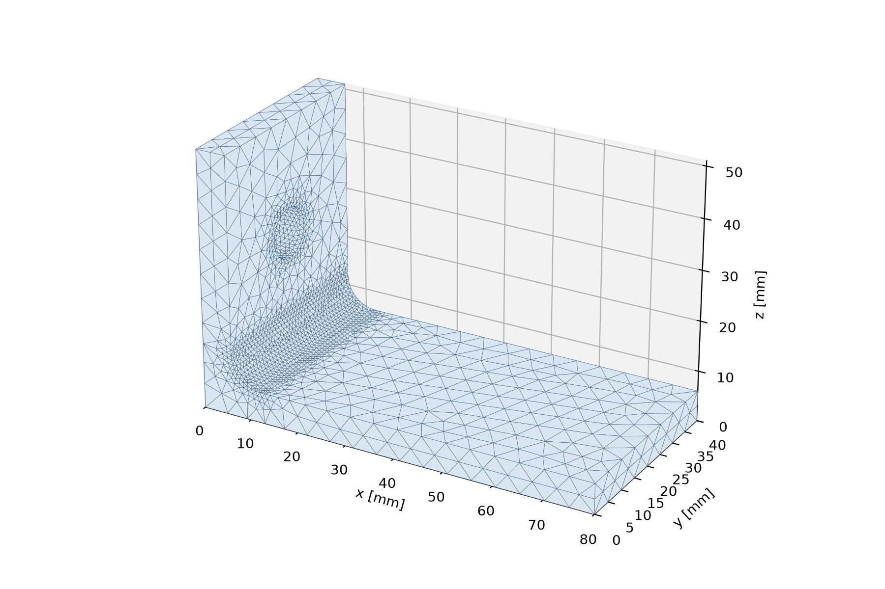
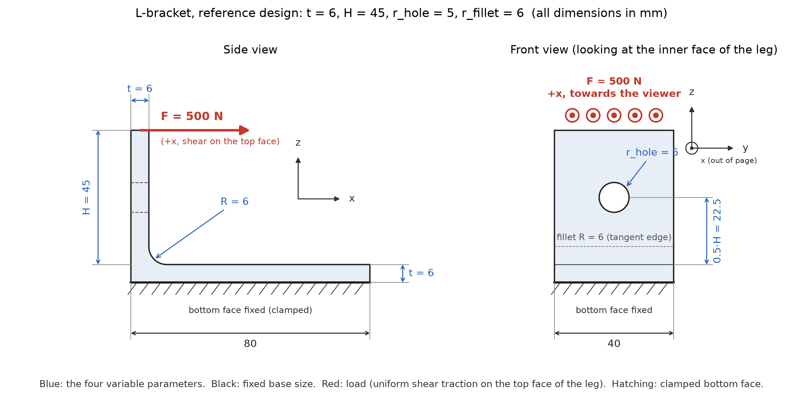
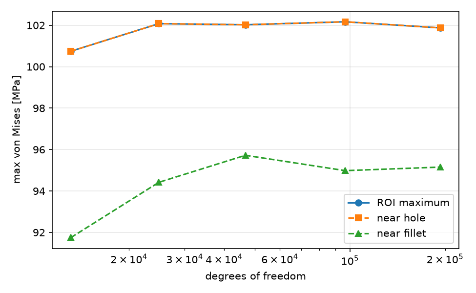
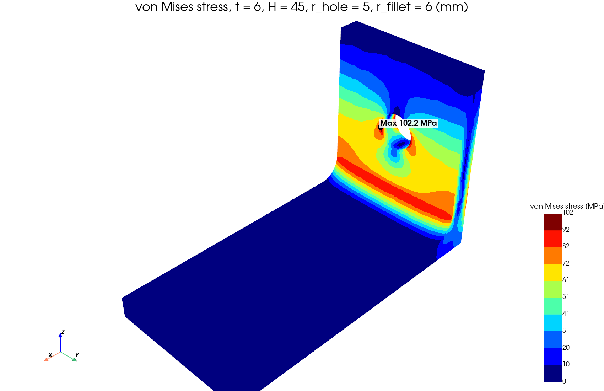
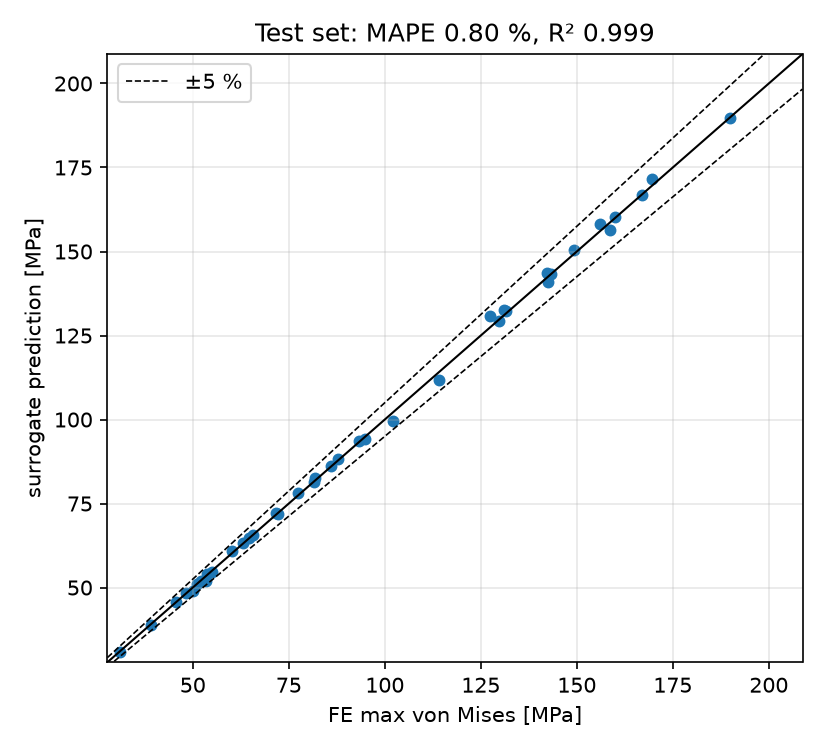
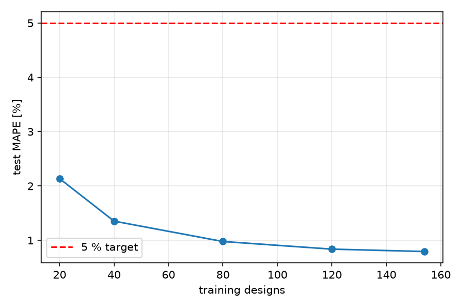

# Parametric L-bracket: mesh convergence study and neural surrogate

An open-source pipeline that builds a parametric 3D bracket, meshes it with controllable local refinement, solves it with finite elements, runs an automated mesh-convergence study with a standardized report, and trains a neural surrogate of the peak stress on 193 simulated designs.



**Headline results** (all measured in this repository, see below for the method)

- The peak von Mises stress converges to about 102 MPa on the reference design, with changes of 0.3 % or less over the last three mesh refinements.
- The neural surrogate reproduces the FE result with a mean error of 0.80 % (worst 2.7 %, R² = 0.999) on 39 held-out designs, and 0.89 % (worst 5.4 %) in repeated cross-validation over all 193 designs.
- A prediction takes about 0.5 ms, against a median of 6 s for the FE solve (more than 10,000 times faster, meshing time not even included).

## Pipeline

```
parameters (t, H, r_hole, r_fillet)
   -> Gmsh/OpenCASCADE geometry + local refinement      src/bracket/geometry.py
   -> mesh quality (aspect ratio, skewness)             src/bracket/quality.py
   -> FEniCSx linear elasticity, ROI stress             src/bracket/fea.py
   -> convergence study + HTML report                   convergence.py, report.py
   -> Latin-hypercube dataset (193 designs)             dataset.py
   -> label audit on a second mesh                      scripts/audit_labels.py
   -> MLP surrogate vs. Gaussian process vs. power law  surrogate.py
```

## Installation

Tested on WSL2 (Ubuntu 24.04) with Python 3.11 and dolfinx 0.11.0.

```bash
git clone git@github.com:YOUR_GITHUB_USERNAME/bracket-pipeline.git
cd bracket-pipeline
conda env create -f environment.yml
conda activate bracket
make test
```

`environment.lock.yml` records the exact package versions used.

## Quickstart

The result files are included, so `make train` and `make test` work without re-running the simulations.

| Command | What it does | Time |
|---|---|---|
| `make mesh` | meshes the reference design, prints quality metrics | seconds |
| `make fea` | one FE solve, prints stress by region and peak location | seconds |
| `make converge` | convergence study and HTML report in `results/` | minutes |
| `make dataset` | 193 designs, resumable | roughly 20-30 min |
| `make audit` | re-solves every design on a second mesh, builds `dataset_clean.csv` | roughly 20-30 min |
| `make train` | trains and evaluates the surrogate | about a minute |
| `make cv` | repeated cross-validation | about a minute |
| `make figures` | geometry drawing and stress contour for this README | under a minute |

Predict a new design:

```bash
python scripts/predict.py --t 7.3 --H 52 --r_hole 4.2 --r_fillet 5.5
```

## Model and parameters

L-shaped bracket: base plate 80 x 40 mm, upright leg of height H with a round hole through its thickness at mid-height, and a rounded inner corner (fillet). The bottom face of the base is clamped. A total force of 500 N acts on the top face of the leg as a uniform shear traction, which bends the leg like a cantilever. Linear elasticity, steel (E = 210 GPa, nu = 0.3), quadratic tetrahedra.

| Parameter | Meaning | Range (mm) |
|---|---|---|
| `t` | plate / leg thickness | 4 - 10 |
| `H` | leg height | 30 - 60 |
| `r_hole` | hole radius | 3 - 8 |
| `r_fillet` | inner fillet radius | 3 - 10 |

Geometries that cannot be built (hole overlapping the fillet or the leg top, oversized fillet) are rejected before meshing.



*Dimensioned views of the reference design (all dimensions in mm). Blue marks the four variable parameters; the base size is fixed. The red arrow shows the load (500 N in +x, a uniform shear traction on the top face of the leg), and the hatching shows the clamped bottom face.*

## Method notes

**Mesh quality.** Aspect ratio is the longest over the shortest tetrahedron edge. Skewness is (V_ideal - V) / V_ideal, where V_ideal is the volume of a regular tetrahedron with the same circumradius (0 is perfect, 1 is degenerate). Both use the four corner nodes of each element. On the reference design the maximum aspect ratio is 3 to 6 and the maximum skewness 0.86 to 0.94, so a few sliver elements survive refinement.

**Stress measure.** The quantity of interest is the maximum von Mises stress in a region of interest (ROI): the lower leg including hole and fillet, excluding the clamped and loaded faces. Stress near a clamped edge or an applied load is singular and grows without bound under refinement, so a global maximum would never converge. The global maximum equalled the ROI maximum in every run, including all 193 dataset designs, including all 193 dataset designs, which suggests the singularities did not dominate at the mesh sizes used.

**Sanity checks.** Tip deflection is compared with Euler-Bernoulli beam theory and peak stress with the nominal bending stress (`tests/test_fea.py`). The beam formula ignores the hole and root flexibility, so only agreement within about 10 % is expected. For the reference design FE gives 0.1046 mm against 0.1004 mm (ratio 1.04); with the 3 mm hole used in the test it is 0.0995 mm.

## Results

### Mesh convergence (reference design t = 6, H = 45, hole 5, fillet 6)



| h_global / h_local (mm) | DOFs | ROI max (MPa) | change |
|---|---|---|---|
| 8.0 / 2.0 | 13,098 | 100.74 | |
| 6.0 / 1.5 | 24,855 | 102.08 | 1.30 % |
| 4.5 / 1.125 | 46,701 | 102.02 | 0.05 % |
| 3.4 / 0.85 | 96,609 | 102.17 | 0.14 % |
| 2.6 / 0.65 | 193,059 | 101.87 | 0.29 % |

Criterion: relative change below 2 % for the last two refinements. The values fluctuate around 102 MPa instead of approaching it monotonically, which is typical when every refinement is a new unstructured mesh. The generated HTML report (`results/convergence_report.html`) adds the quality plots.

### Stress field of the reference design



Von Mises stress on the dataset mesh (h = 3.4 mm, 0.85 mm near hole and fillet), nodal-averaged for display with a banded colour scale. The scale ends at the maximum of the unaveraged element field, which is the value used everywhere else in this README, so the averaged peak shows slightly below the top of the scale. The marker shows where that maximum is.

### Choice of the dataset mesh

The reference design alone suggested h = 4.5 mm was enough. Two extra designs showed otherwise:

- A thick, tall design with hole 3 mm and fillet 2 mm gave stresses between 79.9 and 83.8 MPa across five meshes, with no trend. Its fillet was too small for the mesh. The minimum fillet radius was therefore set to 3 mm.
- With a 3 mm fillet, refining only near the features while keeping h_global = 4.5 mm gave a result 3.1 % above the finest mesh. Refinement settings from the convergence series did better.

The dataset uses h_global = 3.4 mm and h_local = 0.85 mm. On three very different designs this setting is within 0.5 % of the finest mesh (+0.3 %, -0.5 %, +0.1 %).

### Dataset and label audit

193 valid designs from a 200-point Latin hypercube (seed 42; 7 candidates failed the validity check), all solved successfully. Every design was then re-solved on a second mesh (h_global = 3.0 mm). The median difference between the two meshes was 0.30 % and the 95th percentile 1.55 %, which is the noise level of a single-mesh label. One design (id 167) disagreed by 41 % (62.57 MPa on the dataset mesh against 44.29 and 44.53 MPa on two finer meshes). The rule, fixed before the audit: a label is the mean of the two meshes, or the median of three if they differ by more than 3 %. Only design 167 triggered the three-mesh rule, and its label is 44.53 MPa. Raw values stay in `results/dataset.csv`; the cleaned set is `results/dataset_clean.csv`. The faulty label had been spotted earlier because the surrogate's cross-validation error on that design was 28 %.

### Neural surrogate

Inputs are log-transformed and standardized, and the stress is modelled on a log scale. The MLP has two hidden layers of 64 tanh units (L-BFGS, alpha = 0.01), chosen by 5-fold cross-validation on the 154 training designs only. The 39 test designs were used once, for the numbers below. Training and test labels are both the audited labels. On the raw labels (before the audit) the same model had a test MAPE of 1.29 % and a worst error of 9.4 % (`results/surrogate_metrics_raw_labels.json`), so part of the improvement comes from the removed faulty label and from less noisy test labels.



| Model | MAPE | R² | worst error | within 5 % |
|---|---|---|---|---|
| MLP (tuned) | 0.80 % | 0.999 | 2.7 % | 100 % |
| Gaussian process | 0.59 % | 0.999 | 3.5 % | 100 % |
| Power law (log-log linear) | 2.79 % | 0.995 | 7.8 % | 92.3 % |

Repeated 5-fold cross-validation over all 193 designs (3 repeats): MAPE 0.89 %, worst error 5.43 %, 99.8 % of predictions within 5 % (one of the 579 exceeds it).

The Gaussian process is slightly more accurate than the MLP on this split; with 39 test designs the difference is small. The learning curve was still falling at 154 training designs:



**Speed.** One MLP prediction takes about 0.48 ms (2.3 microseconds per design in a batch), against a median of 5.96 s for one FE solve (mesh import, assembly and solve; Gmsh meshing time is not included), a factor of more than 10,000 (about 11,000 and 12,500 in two separate runs).

On an unseen design (t = 7.3, H = 52, hole 4.2, fillet 5.5) the shipped surrogate predicts 83.2 MPa and the FE solution gives 82.1 MPa (1.3 % apart).

## Limitations

- The surrogate reproduces this FE model, not a real part. It is valid only inside the parameter ranges above, for this one load case and fixed base dimensions, and `predict.py` warns when you leave the ranges.
- Linear elasticity only: no plasticity, contact, bolts or fatigue.
- The minimum fillet radius is 3 mm. Smaller fillets were not resolved reliably by the meshes used.
- Labels carry a discretization error of about 0.3 % (median) and up to roughly 3 % (worst) from the two-mesh comparison, so accuracy figures below that level are not meaningful. The audit compares two meshes, so a bias shared by both would stay undetected.
- Sliver elements (skewness up to 0.9 or more) occur even on fine meshes. Skewness alone did not identify the faulty label: two designs had skewness at least as high as design 167, and only one of them was faulty.
- The test set holds 39 designs, so "100 % within 5 %" is an observation, not a guarantee.

## Project structure

```
src/bracket/   geometry, quality, fea, convergence, report, dataset, surrogate
scripts/       command-line entry points
tests/         pytest suite (geometry, FE against beam theory, surrogate accuracy)
results/       convergence study, dataset, audit, trained model, figures
```

## License

MIT, see `LICENSE`.